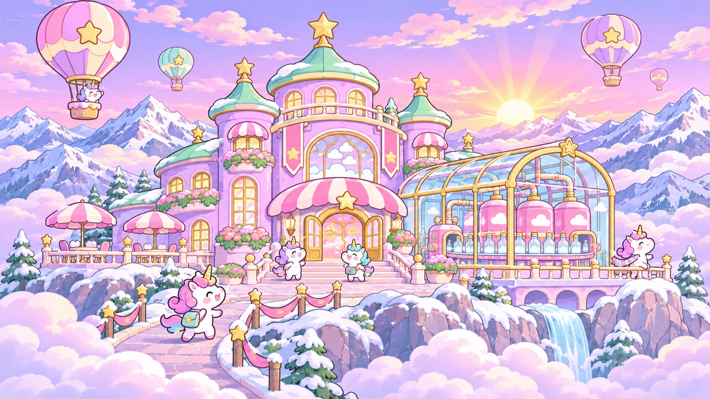

# Unicorn Warehouse

A little more comfort, a little more rest. Explore memberships for the things that make your day.

Unicorn Warehouse is a fictional membership company and a work of satire. Its catalog includes bottled mountain air, a full night of sleep, and warehouse shifts you can work to afford either. You can earn Tokens at one company, save them, and spend them at another. Nothing is for sale.



- **Everair Lodge Collection** · Four seasonal air blends and Summit Reserve, the lodge's signature unscented oxygen.
- **Token Economy** · Pick up a shift at Goodshift or make a sponsored clip with Brightside. Tokens carry over and never expire.
- **Token Redemption** · Spend 5 Tokens to commission a clip, 60 for a premium Lodge Collection canister, or 20 a day for a full night with Dreamwell Complete.

See [Economy Standard](ECONOMY.md) for the wage anchors, household scenarios, and pricing rules.

See [Roadmap](ROADMAP.md) for the plan to turn the site into a playable game, and [Business roadmap](BUSINESS-ROADMAP.md) for the industry-by-industry checklist.

## Run locally

Use Node.js 22 or newer and npm.

```sh
npm ci
npm run dev
```

Open [member sign-in](http://localhost:3000), enter a name, and choose a career track and job. **My account** shows your onboarding objectives and daily actions. **Member Records** downloads a Token statement with your current save. On the sign-in screen, **Resume from a statement** opens the account saved in the original PDF.

Set a shared, random `UW_SESSION_SECRET` in the server environment for production. Member Records uses `UW_RECORDS_SECRET` when set, or `UW_SESSION_SECRET` otherwise. Keep the records signing key stable across deployments and workers so existing PDFs remain valid. Local development creates a gitignored signing key on the first download. Keep that file to restore local saves after restarting the server.

Run `npm run lint` to check the source. To preview a production build, run `npm run build` followed by `npm start`. Next.js downloads the site's fonts from Google Fonts during compilation.

## Project layout

- `src/app` contains the site routes, including Token Economy and Token Redemption.
- `src/content` contains the product catalog and page copy.
- `src/assets` and `public` contain the illustrations and other site artwork.

The site uses Next.js and TypeScript, with GSAP for motion and React Three Fiber for the product scenes.
